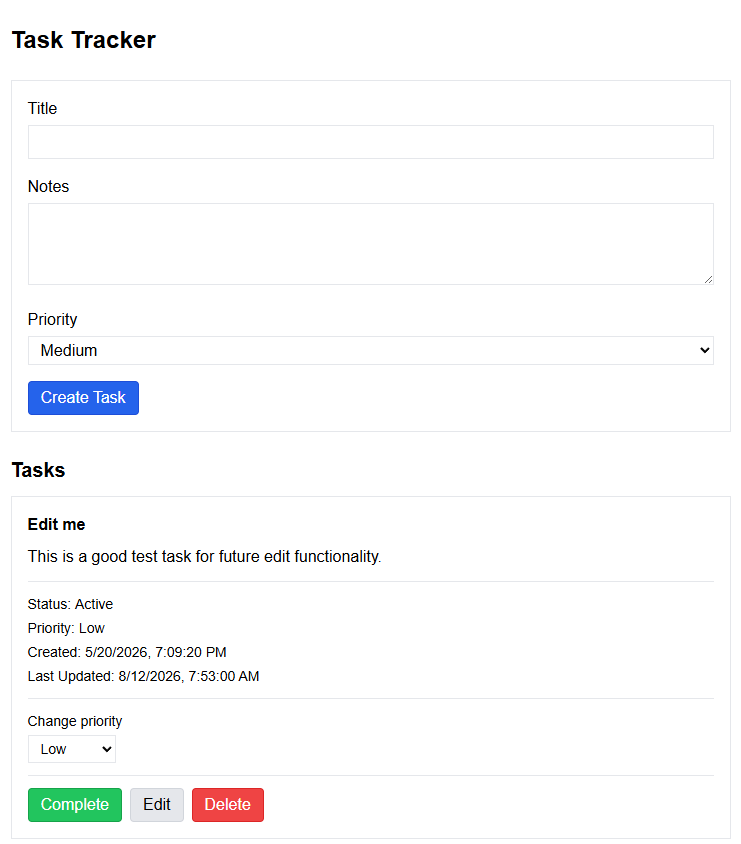
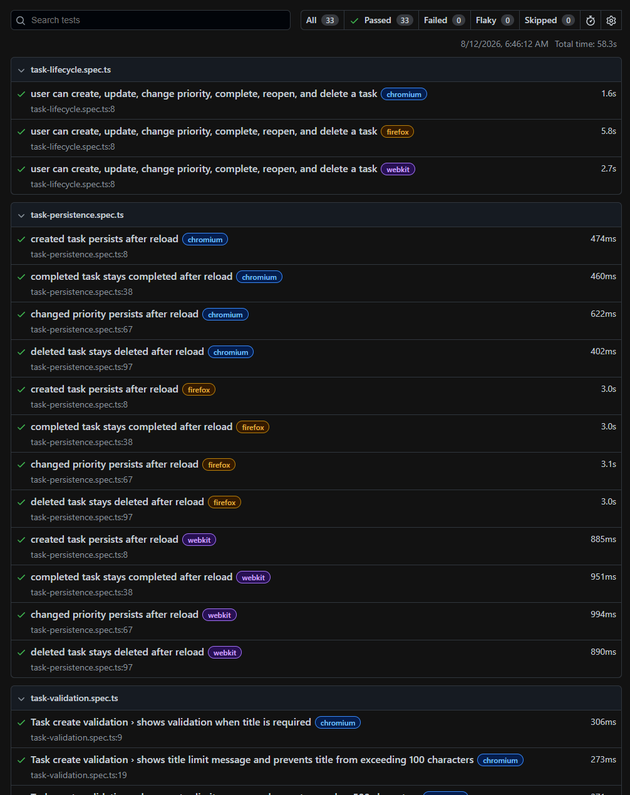
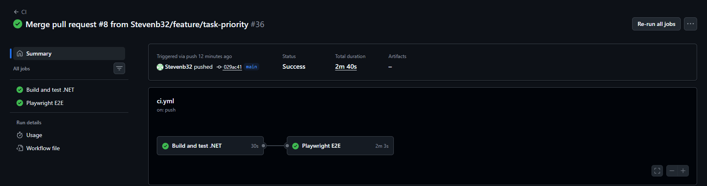

# TaskTracker
[](https://github.com/Stevenb32/TaskTracker/actions/workflows/ci.yml)

TaskTracker is a full-stack task management app built as a QA automation portfolio project. 

The product surface is intentionally small, but the implementation exercises domain rules, API behavior, UI workflows, isolated test data, Dockerized dependencies, CI, and a deployed demo.

Live demo: [https://tasktracker.stevenborkowski.dev](https://tasktracker.stevenborkowski.dev) - (Self-hosted on a Raspberry Pi)

## What It Does

- Create tasks with a required title, optional notes, and priority.
- Use task priorities `Low`, `Medium`, `High`, and `Critical`.
- Default new API tasks to `Medium` when priority is omitted; the UI create form also starts at `Medium`.
- View tasks newest first, edit title/notes, change priority, complete, reopen, and delete tasks.
- Persist tasks in PostgreSQL for local, E2E, and production/demo environments.


## Architecture

| Area | Implementation |
| --- | --- |
| Domain | TaskItem owns task state, validation, lifecycle transitions, and priority changes. |
| API | .NET 10 Minimal API with EF Core and PostgreSQL. |
| UI | React 19, Vite, and Tailwind CSS. |
| Testing | xUnit, FluentAssertions, WebApplicationFactory, and Playwright. |
| Deployment | Docker Compose, Nginx /api routing, PostgreSQL 17, and a manual production deploy workflow. |

## Testing And Quality

- Domain tests for business rules and validation.
- API integration tests through WebApplicationFactory.
- PostgreSQL-backed Playwright E2E across Chromium/Firefox/WebKit.
- GitHub Actions running automated validation on pushes/PRs.

## Preview

### Application UI



### Playwright E2E Report



### GitHub Actions CI



## Project Structure

```text
TaskTracker.Domain        Core task domain logic
TaskTracker.Domain.Tests  Domain unit tests
TaskTracker.Api           .NET Minimal API, EF Core model, migrations
TaskTracker.Api.Tests     API integration tests
TaskTracker.Ui            React frontend
TaskTracker.E2E.Tests     Playwright E2E tests
docs                      Setup, testing, demo, and screenshots
scripts                   Demo database utility scripts
sql                       Local database helper queries
```

## Documentation

- [Setup](docs/setup.md) - local development and E2E environment
- [Testing](docs/testing.md) - automated testing strategy and commands
